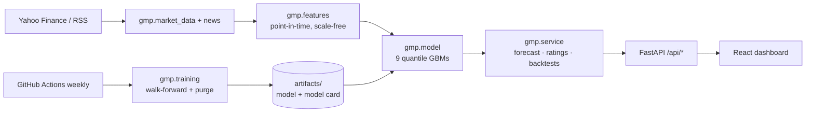

# Global Market Predictor

A full-stack quant research app: a **quantile gradient-boosting forecaster** for US large caps, a **3-engine stock rating** (value, news sentiment, momentum), a **market Fear & Greed index**, and **paper-trading backtests**. Every number in the UI is computed from market data. Nothing is hard-coded or randomly generated.

**Stack:** FastAPI · scikit-learn · pandas · yfinance · React 19 · Vite · Tailwind · Recharts · GitHub Actions · Docker

## What it does

| Feature | How it works |
| --- | --- |
| **Forecast cone** | 10th/50th/90th percentile of 1, 5 and 10-day returns, drawn on the price chart for the next 10 NYSE sessions |
| **Consensus rating (0–100)** | DeepValue (fundamentals vs peers) + Sentiment NLP (headlines) + Tech-Momentum (trend factors + ML). A Buy needs 2 of 3 engines bullish |
| **Model track record** | Out-of-sample hit rate vs an "always up" baseline, 80% band coverage, rank IC with t-stat, all shown in the UI |
| **Mock portfolio** | $10k single-stock backtest on out-of-sample signals, next-open fills, 10 bps costs, vs buy-and-hold |
| **Signal portfolio** | $100k weekly top-5 model portfolio across 20 stocks, with equity curve, blotter, win rate and live marks |
| **Fear & Greed** | Six components (momentum, 52-week highs/lows, breadth, VIX, safe-haven demand, junk-bond demand), each scored as a percentile of the past year |

## Architecture



## Modelling choices (and why)

- **Vol-scaled targets.** The model predicts `log return / (trailing daily vol × √h)`, so one pooled model can learn from about 95 stocks with very different volatility.
- **Scale-free, point-in-time features.** Returns, ratios, z-scores and cross-sectional ranks, never raw price levels. `tests/test_features.py` checks that changing future prices leaves past features untouched (no look-ahead).
- **Walk-forward validation with a purge gap.** Expanding window. The 10 days before each test block are dropped, because 10-day labels would otherwise overlap the test set.
- **Honest baselines.** Direction accuracy is compared with "always up" (stocks drift upward), and quantile loss with the unconditional distribution.
- **Skill-gated ML.** The ML forecast's weight in the momentum engine follows its own out-of-sample rank-IC t-stat. A model without proven skill can't drive ratings.
- **News isn't a model feature.** There is no point-in-time news archive, and back-filling one would leak the future into backtests. Sentiment is a separate, live-only engine.

## Current model results (out-of-sample)

The shipped artifact was trained on a 2-year snapshot (85 stocks, 2024-06 → 2026-03), with 5 walk-forward folds tested on 2025-06 → 2026-03. Full details are in [`artifacts/model_card.json`](artifacts/model_card.json).

| Horizon | Hit rate | "Always up" | 80% band coverage | Rank IC (t) |
| --- | --- | --- | --- | --- |
| 1 day | 51.5% | 52.4% | 77.4% | −0.008 (−0.7) |
| 5 days | 48.7% | 54.7% | 79.4% | −0.041 (−3.7) |
| 10 days | 49.0% | 56.2% | 80.0% | −0.044 (−4.5) |

**What this shows:** the **risk bands are well calibrated**, and the tail quantiles beat the baseline. The **direction** of the median has no edge yet on this short sample. The app therefore weights the ML direction at 0%. The weekly CI retrain on 10 years of data updates these numbers.

## Run it

```bash
pip install -r requirements-dev.txt
```

```bash
uvicorn gmp.app:app --reload
```

```bash
cd frontend && npm ci && npm run dev
```

API docs are served at `http://localhost:8000/docs`. You can also run everything with `docker compose up`.

Retrain the model:

```bash
python -m gmp.training --period 10y
```

Run the tests (fully offline, synthetic data):

```bash
pytest
```

Configuration lives in [`.env.example`](.env.example). No API keys are needed. An optional `FINNHUB_API_KEY` stays server-side.

## Project layout

```
gmp/            backend package (features, model, training, engines, API)
artifacts/      shipped model, model card, out-of-sample predictions
tests/          pytest suite (look-ahead, backtest fills, API end-to-end)
frontend/src/   React app: pages/, components/, lib/ (API client, hooks)
.github/        CI (lint, tests, build) + weekly retrain
```

*Research project, not investment advice.*
